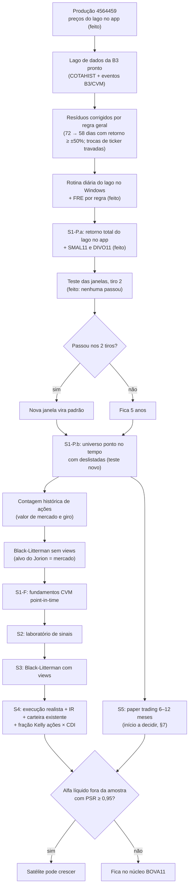

# Roteiro do Otimizador B3: do protótipo a uma carteira realista e competitiva

_Atualizado em 2026-10-17, noite (S1-P.a na produção: preços diários do lago da B3 no app; SMAL11 e DIVO11 no
walk-forward; rotina diária do lago agendada no Windows; flags reabertas/atrasadas e janela do FRE corrigidas).
Produção: `main` = `4564459`
(https://portfolio-optimization-b3.streamlit.app/).
Branch de trabalho: `feat/s1p-precos`._

---

## 1. Onde estamos

| Parte | Situação |
|---|---|
| Motor de otimização (Kelly, Máx. Sharpe, Mín. Variância, HRP; tetos por ação, setor e vol) | Nível profissional, testado (231 testes) |
| Estimação (Ledoit-Wolf + Jorion) | Correta; μ = média histórica (o ponto fraco) |
| Walk-forward (fora da amostra, custos, BOVA11 na mesma data) | Honesto desde `8b6551b` |
| Métricas estatísticas e financeiras (Sharpe, Sortino, PSR/DSR, CAGR, MDD, CVaR, alfa) | Corretas, já auditadas |
| Dados de preço | **Lago de dados da B3 desde `4564459`**: retorno total do COTAHIST com proventos oficiais, JCP líquido e cisões (`lago/precos_diarios.parquet`, 380 papéis desde 2005), atualizado toda noite no lago e versionado no app nos marcos. **Ainda com viés de sobrevivência**: o universo é a lista de hoje (S1-P.b) |
| Growth Score (indicadores contábeis) | Fora da tela desde `55fb9b5`; código guardado em `core/growth.py`, não testado |
| Execução (custo por liquidez, IR, carteira existente) | Não modelada |

**Último resultado fora da amostra** (treino de 5 anos, teste de 3 anos, 11/2023 a 10/2026, teto de 30% por setor):

Com os preços do lago (2026-10-17, padrão da tela, 11/2023 a 10/2026):

| | Otimizada (Kelly) | BOVA11 | SMAL11 | DIVO11 |
|---|---|---|---|---|
| CAGR | 20,8% | 21,1% | 9,5% | 21,6% |
| Sharpe | 0,50 | 0,50 | −0,02 | 0,56 |
| Drawdown máximo | **−12,3%** | −16,2% | −26,2% | −16,1% |

Leitura: **empate estatístico com o índice** (erro do Sharpe ≈ ±0,5 num período só), com queda menor; o DIVO11
(dividendos) foi a melhor referência no período. Vantagem de retorno **não comprovada**. Com o Yahoo, o mesmo
protocolo dava 20,0% × 21,3% e Sharpe 0,42 × 0,47. Teste das janelas (outro protocolo, 7,6 anos): ver §4.2.

**Kelly × outros objetivos** (2026-10-16, mesmos dados do Yahoo): o Kelly fica como opção, **não como objetivo
principal**. Em 10 anos a Mín. Variância teve Sharpe parecido com metade do drawdown (−29% × −55%); o Kelly venceu
em 5 anos. O rótulo "recomendado" do Kelly só muda depois do teste núcleo + satélite (§7).

---

## 2. Critério de "pronto" (fixado antes, não muda depois de ver resultado)

O otimizador só pode receber mais dinheiro quando tiver as três coisas abaixo:

1. **Alfa líquido** de custos e de IR contra o Ibovespa (BOVA11), **fora da amostra**, com **PSR ≥ 0,95**;
2. medido sobre **dados honestos** (com deslistadas e proventos oficiais, ou seja, depois do S1-P);
3. confirmado por **6 a 12 meses de paper trading** registrado (S5).

Até lá, a regra para dinheiro real: **BOVA11 no núcleo, otimizador como satélite pequeno**, só dinheiro de 5 anos
ou mais, rebalanceio trimestral.

---

## 3. Fluxo de tarefas

---

## 4. Checklist

### 4.1 Feito

- [x] Otimizador convexo (cvxpy): Kelly λ, Máx. Sharpe exato (Charnes-Cooper), Mín. Variância, HRP e HRP-Árvore
- [x] Ledoit-Wolf + shrinkage de Jorion; teto de vol como cone de segunda ordem; cardinalidade em 2 etapas
- [x] Walk-forward fora da amostra com custos (10 bps por lado), falhas registradas, sem troca silenciosa por 1/N
- [x] PSR e DSR (Bailey e López de Prado); alfa de Jensen com estatística t; benchmark BOVA11 (retorno total)
- [x] Correções de métricas: Sortino (downside deviation), Calmar, alfa por regressão, curtose em excesso
- [x] Reamostragem (bagging) avaliada com pré-registro: não aprovada, ficou opcional e desligada
- [x] Plano de compra: quantidade de ações com cotação do dia; sobra de caixa ≤ 0,8% de R$ 300 a R$ 50 mil
- [x] Teto por setor (padrão 30%) na carteira, no plano de compra e no walk-forward
- [x] Walk-forward treina na mesma janela da carteira de hoje; BOVA11 começa na mesma data (`8b6551b`)
- [x] Growth Score fora da tela (`55fb9b5`); Reboot e conferência ao vivo feitos
- [x] Teste das janelas (código, pré-registro e tiro 1) na `main` (`f12ed03`)
- [x] Lago de dados da B3 (projeto `b3-datalake`, fora deste repositório): COTAHIST 1986–hoje, eventos da B3 +
      flags do COTAHIST + CVM FRE, retorno total com JCP líquido, 3.948 papéis com deslistados e em recuperação
      judicial; repositório privado `GabrielScript/b3-datalake`
- [x] Erros de ajuste do lago corrigidos por regra geral, não papel por papel (§4.3); trocas de ticker travadas numa
      tabela versionada; duas rodadas seguidas do lago dão tabelas idênticas
- [x] Teste Kelly × outros objetivos: Kelly fica como opção, não como principal (§1)
- [x] Tamanho do universo ponto no tempo (pisos R$ 1 mi e R$ 5 mi, 80% e 90% dos pregões) e triagem dos resíduos do
      ajuste nesse universo (§4.3)

### 4.2 Teste pré-registrado das janelas: encerrado, fica a janela de 5 anos

- [x] `pesos_ewma` e `covariancia_ewma` (EWMA com encolhimento Ledoit-Wolf), com TDD
- [x] `estimar_momentos(..., meia_vida_cov=...)`: Σ EWMA também alimenta o Jorion
- [x] `com_janela(estrategia, pregoes)`: janelas diferentes nas mesmas datas e no mesmo universo
- [x] `estrategia_otimizada(..., meia_vida_cov=...)`
- [x] `scripts/avaliar_janelas.py` com a regra de decisão `decidir` testada (`4b6394e`)
- [~] Revisão adversarial do pré-registro: parcial (só a sonda terminou; workflow parado por custo)
- [x] Pré-registro no docstring do script, commitado **antes de rodar** (`7d5c6cb`)
- [x] Tiro 1 (dados Yahoo), 2026-10-15: saída completa em `docs/janelas-tiro1-2026-10-15.txt`
- [x] Tiro 2 (dados do lago, 2026-10-17, pregão fechado de 16/10/2026, mesmo script): saída em
      `docs/janelas-tiro2-2026-10-16.txt`. **Nenhuma desafiante passou: fica a R5.** Mede só a correção de preços nas
      sobreviventes: o viés de sobrevivência fica para o teste novo do S1-P.b

Candidatas: R5 (controle, padrão atual), R3, R2 e EWMA (Σ com meia-vida de 6 meses e μ de 5 anos). Troca só se
P[candidata > R5] ≥ 0,983 (Bonferroni), drawdown não piorar mais de 5 p.p. e giro ≤ 2× nos **dois** tiros.
Expectativa registrada antes: "inconclusivo, fica 5 anos". **Errou** (ver abaixo).

**Tiro 1** (52 ações, fora da amostra de 19/02/2019 a 15/10/2026, 1.906 pregões, 10 bps por lado):

| | R5 (controle) | R3 | R2 | EWMA | 1/N | BOVA11 |
|---|---|---|---|---|---|---|
| CAGR | 18,5% | 28,9% | 33,0% | 25,0% | 14,8% | 10,7% |
| Sharpe | 0,43 | 0,74 | 0,85 | 0,61 | 0,31 | 0,16 |
| Drawdown máximo | −45,0% | −52,3% | −52,4% | −49,4% | −48,8% | −46,9% |
| Giro anual | 177% | 207% | 232% | 205% | 63% | 13% |
| P[> R5] | — | 0,982 | 0,994 | 0,991 | 0,274 | 0,085 |

Veredito pré-registrado: **EWMA passou nos 3 critérios** (C1 0,991 ≥ 0,9833; drawdown 4,4 p.p. pior, limite 5;
giro 1,16×). R2 passou no C1 e caiu no C2 (7,4 p.p. pior). R3 caiu no C1 (0,982, por 0,001) e no C2.
Margens da EWMA são estreitas (0,6 p.p. no C2). **O app não muda**: só troca se a EWMA passar também no tiro 2.

Leitura (hipóteses, não conclusões):
- A expectativa errou porque usou o erro do Sharpe (±0,4) como régua; a decisão usa o PSR da série diferença, que
  cancela o ruído comum de estratégias muito correlacionadas e tem mais poder.
- O Sharpe cresce com a "recência" (R2 > R3 > EWMA > R5). Mecanismo plausível: o universo é a lista líquida de
  hoje, escolhida pelo tamanho no fim do período; μ de janela curta reage mais rápido aos vencedores que essa
  escolha favorece. É exatamente o que o tiro 2 (com deslistadas) separa.
- Os saltos suspeitos do Yahoo ficaram como estavam (regra do pré-registro). O diagnóstico abaixo mostra que a
  aprovação da EWMA depende deles.

**Diagnóstico dos saltos** (não muda o veredito; saída em `docs/janelas-tiro1-saltos.txt`). Mesma rodada do tiro 1
com dados até 14/10 (o Yahoo mudou o 15/10 depois do tiro): mesmos MDD e mesmo giro total, ou seja, mesmos pesos.

| Dia (salto do Yahoo) | Peso R5 | Peso R3 | Peso R2 | Peso EWMA | Ganho/perda falso EWMA − R5 |
|---|---|---|---|---|---|
| 01/03/2021 PCAR3 +112% | 3,6% | 0% | 0% | **14,4%** | **+12,1 p.p.** |
| 28/06/2021 UGPA3 +119% | 0% | 0% | 0% | 0% | 0 |
| 23/08/2023 PCAR3 −67% | 4,7% | 6,1% | 0% | 0% | +3,1 p.p. |

- **P[EWMA > R5] cai de 0,991 para 0,956 sem esses 3 dias**: abaixo de 0,9833, a EWMA não passaria no C1. A
  aprovação do tiro 1 vem, em boa parte, de um único dia com preço errado. R2 (0,994 → 0,995) e R3 (0,982 → 0,989)
  quase não mudam. Essa conta só tira o efeito direto (o dia inteiro); não desfaz o efeito pelo treino.
- Os saltos também entram pelo treino: os dois saltos de PCAR3 em 2017 (+139%, +78%) inflam o μ por 5 anos; com eles
  na janela, a EWMA põe 8–9% em PCAR3 (média geral 3,4%). Com o salto de 2021 na janela, a R2 chegou a 10,7% de
  PCAR3 (média 2,8%): se isso ajudou ou atrapalhou a R2, esta saída não mostra.
- **Mecanismo (hipótese para o tiro 2)**: a EWMA usa μ de 5 anos e Σ de meia-vida de 6 meses. O μ lembra um salto por
  5 anos; o Σ esquece a variância dele em ~1 ano. O papel parece ter retorno alto e risco baixo, e a EWMA carrega. Com
  dados corretos isso vale para saltos reais também (ex.: AXIA3 em 2017, se for real).
- Nenhum salto cai dentro da janela do drawdown máximo (todas em fev–mar/2020): o C2 não depende deles.
- Prováveis eventos societários (a conferir na sonda do S1-P): PCAR3 01/03/2021 = cisão do Assaí; PCAR3 23/08/2023 =
  cisão do Éxito; AXIA3 22/08/2017 (+49%) pode ser real (anúncio da privatização da Eletrobras). UGPA3 28/06/2021,
  PRIO3 (2015, 2016) e PCAR3 (2017) sem explicação ainda. **O S1-P precisa tratar cisões**, não só proventos e
  desdobramentos.
- O 15/10/2026 do tiro 1 provavelmente era o preço com o pregão aberto (o Yahoo reescreveu esse dia depois): no
  tiro 2, passar a data de um pregão já fechado.
- Tiro 2 com "o mesmo script": o S1-P.a deve entrar por trás de `market_data.carregar_precos`; se precisar de outra
  porta de entrada, só a `carregar()` muda. Decidir isso no desenho do S1-P.a.
- R5 contra o BOVA11 aqui (18,5% × 10,7%) não contradiz o §1 (20,0% × 21,3%): outro protocolo (7,6 anos × 3; 52
  ações × 57) e as estratégias rodam sobre sobreviventes, o BOVA11 não. Mesmo assim P[R5 > BOVA11] ≈ 0,915 < 0,95.

**Tiro 2** (50 ações, fora da amostra de 20/03/2019 a 16/10/2026, 1.888 pregões; PCAR3 e SUZB3 saem por migração
de classe sem continuidade no lago, SIMH3 entra com a história da JSL):

| | R5 (controle) | R3 | R2 | EWMA | 1/N | BOVA11 |
|---|---|---|---|---|---|---|
| CAGR | 20,4% | 28,4% | 28,3% | 19,1% | 15,3% | 10,7% |
| Sharpe | 0,49 | 0,71 | 0,70 | 0,44 | 0,32 | 0,16 |
| Drawdown máximo | −44,3% | −54,1% | −58,1% | −49,1% | −50,0% | −46,9% |
| Giro anual | 162% | 204% | 242% | 189% | 63% | 13% |
| P[> R5] | — | 0,950 | 0,918 | **0,373** | 0,217 | 0,043 |

Veredito: **a EWMA caiu no C1** (0,991 no tiro 1 → 0,373): sem o salto falso de +112% da PCAR3 em 2021, a vantagem
some, como o diagnóstico do tiro 1 previa. R3 e R2 caem no C1 e no C2 (drawdown 9,8 e 13,7 p.p. pior). **A janela
do app continua 5 anos.** O Sharpe ainda cresce com a recência (R3/R2 > R5), mas com drawdown bem pior e sem
significância; a hipótese do viés de sobrevivência (lista de hoje favorece janela curta) só o S1-P.b testa.

### 4.3 S1-P.a: preços corrigidos no app (a partir do lago da B3)

- [x] Triagem dos resíduos do ajuste no universo ponto no tempo, com deslistadas (saída completa em
      `docs/universo-residuos-2026-10-16.txt`; lista em `docs/universo-saltos-2026-10-16.csv`; script
      `scripts/universe_residuals.py` no repositório do lago). Dos 3.449 saltos sem explicação, só **24** caem no
      universo mais largo (R$ 1 mi, 80%); dos 17 + 404 eventos da CVM sem match, só **8**. Efeito máximo num índice de
      pesos iguais do universo: +11 a +27 bps/ano. Olhando o preço de cada um: 6 já estão certos (cisões do Assaí, do
      Éxito, Bradespar, Telebrás PN), 5 da CVM não mexem no preço, 2 são reais (fraude da Americanas, tick da Ambipar)
      e **~12 estão errados** com causa identificada (BBDC3 2004, PMAM4 2008, ETER3 2007, LAME3/4 2021, JSLG3 2020,
      TELB3 1998, CST 6 1995, ELET6 1997, LIPR3 1998, CESP3 1999) + 4 a conferir (TLCP4 2005, BRPR3 2023, AMER3 2024,
      RCSL3 2023)
- [x] Erros corrigidos por regra geral (2026-10-17): classe irmã (evento confirmado numa classe vale para a irmã que
      salta pelo mesmo fator), FRE da CVM com veto do preço, flag grudada na classe, troca de ticker por regra estrita
      (81 ligações, como ITAU4 → ITUB4 e BRDT3 → VBBR3; amostra de 10 com notícia: 5 confirmadas, 0 contraditas) e
      tabela de correções manuais com evidência (JSLG3 → SIMH3, LAME → AMER3, RCSL3/4, PETZ3, quebras sem fonte).
      No universo: dias com retorno total ≥ ±50% caem de 72 para 58 (os erros sumiram, nenhum dia novo); saltos sem
      explicação, de 24 para 20. Saídas em `docs/universo-*-2026-10-17.*`
- [x] Trocas de ticker travadas em `corrections/corrections.csv`: a regra só propõe ligações novas, para revisão; e
      gold reproduzível (o Polars embaralhava a ordem das linhas em três escolhas; duas rodadas agora são idênticas)
- [x] Rotina diária do lago no Windows (`b3lake daily`, tarefa "b3lake daily" no Agendador): seg–sex 21h45 com novas
      tentativas até 23h45 e às 8h; portões (troca de ticker sem revisão, arquivo truncado, |retorno| ≥ 50% em papel
      líquido sem revisão, gold reproduzível na rodada semanal); aviso no Windows só quando falha. Aceite: o pregão
      de 16/10/2026 entrou em 28 min (hoje ~10 min: só os emissores com flag nova buscam eventos)
- [x] Erros pequenos em dia de evento, por regra: flag B/G reaberta em ≤ 10 dias = mesmo aviso (salvo quebra grande no
      preço); flag atrasada ≤ 30 dias depois de evento da B3; janela do FRE de 150 dias (bancos esperam o BACEN).
      Corrigidos: ITUB3/4 2009 (×1,15 + ×1,05 → ×1,10), SBSP3 02/01/2026 (+4,75% falso), VIVT3 28/04/2025 (+5,3%),
      CGRA3 02/01/2026, CEBR3/5/6 2021; nenhum outro retorno mudou
- [~] Portão de erro pequeno: medido (31 eventos pequenos suspeitos em papel líquido, 12 só com flag), sem regra que
      separe erro de bonificação real; fica como lista de revisão
- [x] Retorno total do lago por trás de `carregar_precos` (índice do `ret_total` ancorado no último fechamento;
      retorno desconhecido = índice parado); a tela mostra até que pregão vão os preços (`4564459`)
- [x] SMAL11 e DIVO11 ao lado do BOVA11 no walk-forward (mesmo cfg, fora do N do DSR; alfa contra o BOVA11)
- [x] Tiro 2 do teste das janelas (§4.2): fica a R5

### 4.4 S1-P.b: universo sem viés de sobrevivência (teste novo)

- [ ] IPCA (SGS 433) para o piso de liquidez: **R$ 1 mi/dia corrigido pelo IPCA** (decidido); o lago ainda não tem IPCA
      (a medição de 2026-10-16 baixou a SGS 433 pelo `core/bcb.py`)
- Tamanho medido (emissores, regra D1, reais de 09/2026): R$ 1 mi e 90% → mínimo de 36 (12/1995), ≥ 50 desde 2000,
  ≥ 119 desde 2010, **173 hoje**; R$ 5 mi e 90% → menos de 30 em 56 meses (todos de 1995 a 2000), ≥ 50 desde 2005,
  **137 hoje**. 80% × 90% muda de 1 a 8 papéis. Já passaram pelo universo de R$ 1 mi 570 papéis, 57% hoje deslistados
- [ ] Universo ponto no tempo: em cada rebalanceio, só as ações líquidas naquela data (critério fixado no pré-registro)
- [ ] Walk-forward com universo dinâmico: a deslistada sai no último fechamento
- [ ] Pré-registro próprio contra o BOVA11; refazer o Kelly × objetivos e o teste núcleo + satélite sobre esses dados
- [ ] Recalcular e publicar os números novos (devem cair: o viés some)

### 4.5 Black-Litterman sem views (aguarda decisão)

- [ ] Contagem histórica de ações (CVM FRE) para valor de mercado e giro; chave pronta: CNPJ → código CVM → emissor da B3
- [ ] Alvo do Jorion = retorno de equilíbrio de mercado Π = δΣw_cap (w_cap = nº de ações × preço, em cada data)
- [ ] Avaliar com protocolo pré-registrado contra o padrão atual

### 4.6 S1-F: fundamentos point-in-time

- [ ] Demonstrações da CVM (DFP + ITR) com **data de entrega** (sem look-ahead)
- [ ] Permite pôr indicadores contábeis no walk-forward pela primeira vez

### 4.7 S2: laboratório de sinais (onde pode nascer o alfa)

- [ ] Sinais candidatos com evidência na literatura: **valor** (P/L, P/VP, EV/EBITDA), **qualidade** (ROE, ROIC,
      margens, dívida líquida/EBITDA), **dividend yield**, **momentum 12−1** (pulando o último mês), **baixa vol**
- [ ] Bancos e seguradoras com métricas próprias (não usar "receita" e "FCF" de empresa não financeira)
- [ ] 10+ anos, pré-registro, custos; conferir contra os fatores NEFIN
- [ ] Reescrever ou aposentar o Growth Score atual (P&D quase constante na B3, "TAM" sem evidência)

### 4.8 S3: Black-Litterman com views

- [ ] Views dos sinais aprovados no S2, confiança Ω pelo IC histórico de cada sinal
- [ ] Opcional: Plano B macro (views de setor por juros, câmbio e commodities)

### 4.9 S4: execução realista

- [ ] Custo por liquidez (proporcional a √(ordem / volume)), não 10 bps fixos
- [ ] Zona de não negociação (só rebalancear quando o desvio compensa o custo)
- [ ] IR: 15% sobre ganho; isenção de vendas até R$ 20 mil/mês; JCP e dividendos
- [ ] Partir da **carteira que já existe** (posições atuais) e rebalancear a partir dela
- [ ] **Fração Kelly ações × CDI**: quanto do dinheiro vai para ações, considerando a incerteza do prêmio de risco
      (hoje o app fica sempre 100% em ações)

### 4.10 S5: paper trading

- [ ] Decidir quando o relógio começa (§7)
- [ ] Carteira registrada a cada rebalanceio, com data e preço, sem ajuste retroativo
- [ ] 6 a 12 meses; comparar com BOVA11 e CDI pelo critério da seção 2

---

## 5. Realista × competitivo

| Tema | Hoje | Realista (mínimo para usar) | Competitivo (padrão de gestora quant) |
|---|---|---|---|
| Dados de preço | Yahoo, só sobreviventes (lago da B3 pronto, não ligado) | Lago da B3: proventos oficiais + deslistadas (S1-P.a/.b) | Base point-in-time auditada, eventos corporativos conferidos |
| Retorno esperado (μ) | Média histórica | Shrinkage para o mercado (BL sem views) | Sinais validados fora da amostra (S2/S3) |
| Covariância (Σ) | Ledoit-Wolf | LW ou EWMA, escolhida por teste | Modelo de fatores de risco (setor, estilo, macro) |
| Indicadores contábeis | Growth Score fora da tela | Desligado até validar | Fatores de valor e qualidade point-in-time (S1-F/S2) |
| Custos | 10 bps fixos | Custo por liquidez + zona de não negociação | Modelo de impacto calibrado com execuções reais |
| Impostos | Ignorados | IR 15% + isenção de R$ 20 mil/mês | Rebalanceio que otimiza o IR |
| Validação | WF de um caminho, PSR/DSR | Pré-registro + dados honestos + 2 tiros | Vários períodos, CPCV, paper trading, auditoria |
| Tamanho da aposta | 100% em ações | Núcleo BOVA11 + satélite | Fração Kelly com incerteza do prêmio |

---

## 6. Riscos e pendências técnicas abertos

- BCB SGS 12 (CDI) falhou em 2026-10-15: o app cai na Selic constante com aviso (Sharpe aproximado).
- A linha do `app.py` que passa os grupos ao plano de compra não tem teste de app próprio (coberta no core).
- O "retorno esperado" na tela é dentro da amostra (~29%) e otimista: rotular como estimativa, não previsão.
- t do alfa sem correção para autocorrelação (Newey-West); VaR paramétrico ao lado de CVaR histórico.
- O 1º carregamento faz dois downloads do Yahoo (janela e janela + teste).
- Ação sem cotação: a reescala dos pesos pode levar um setor acima do teto no plano.
- Cosmético: a legenda do walk-forward diz "ano(s)".
- Limite de N ações junto com o teto por setor pode cair no caminho alternativo (fallback) da otimização.
- O README e o rótulo do objetivo no app ainda chamam o Kelly de "recomendado" (conflita com o §1; muda depois do
  teste núcleo + satélite).
- Lago da B3: triagem do FRE no universo e portão de erro pequeno pendentes (§4.3); direitos de subscrição fora do
  retorno total (AMER3 2024); ligações por regra sem fonte aberta (5 de 10 na amostra); sem IPCA; sem rotina
  agendada (um pregão atrás); BDRs e ETFs só com preço cru (fora do universo e das auditorias); debêntures quase
  não aparecem no COTAHIST.
- Depois de todo push na `main`: Reboot do app no Streamlit Cloud.

## 7. Decisões que dependem do usuário

1. Rodar o teste pré-registrado núcleo + satélite (núcleo Mín. Variância ou BOVA11, satélite Kelly)?
2. Quando começa o relógio do paper trading: logo depois do S1-P.a ou depois do S1-P.b (recomendado: S1-P.b, para
   contar o tempo já na estratégia que vai ser usada)?
3. Quais exports do lago entram no repositório (o painel mensal tem 17,8 MB)? Decidir no desenho do S1-P.a.
4. Black-Litterman sem views: avaliar como alvo do Jorion?
5. Mostrar no app a fração Kelly ações × CDI (S4)?
6. Debêntures: ficam fora do escopo deste otimizador de ações (só entram se virarem um produto novo)?
7. Piso de liquidez do universo: manter o decidido em 2026-10-14 (**R$ 1 mi/dia e 90% dos pregões**) ou trocar pelo
   R$ 5 mi da arquitetura v1? A medição (§4.4) mostra que 80% × 90% não muda quase nada e que R$ 5 mi deixa o universo
   com menos de 30 empresas de 1995 a 2000 (recomendado: manter R$ 1 mi; o tamanho da ordem frente ao volume entra
   no S4 como teto por posição, que depende do capital).
8. "Comparar todas as estratégias possíveis": cada estratégia comparada entra no N do DSR (mais tentativas, mais chance
   de a melhor ganhar por sorte). Recomendado: lista fechada no pré-registro do S1-P.b.

Decidido em 2026-10-17: terminar a B3 primeiro; depois, alocação entre classes (ações B3 × ETFs e BDRs de exterior ×
ETFs de cripto × CDI) com dados que já estão no lago; dados crus dos EUA e de cripto só se essa camada mostrar que vale.
