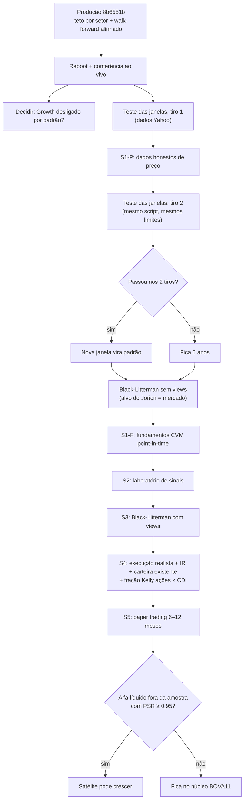

# Roteiro do Otimizador B3: do protótipo a uma carteira realista e competitiva

_Atualizado em 2026-10-15 (depois do tiro 1 do teste das janelas). Produção: `main` = `8b6551b`
(https://portfolio-optimization-b3.streamlit.app/).
Branch de trabalho: `feat/teste-janelas`._

---

## 1. Onde estamos

| Parte | Situação |
|---|---|
| Motor de otimização (Kelly, Máx. Sharpe, Mín. Variância, HRP; tetos por ação, setor e vol) | Nível profissional, testado (230 testes) |
| Estimação (Ledoit-Wolf + Jorion) | Correta; μ = média histórica (o ponto fraco) |
| Walk-forward (fora da amostra, custos, BOVA11 na mesma data) | Honesto desde `8b6551b` |
| Métricas estatísticas e financeiras (Sharpe, Sortino, PSR/DSR, CAGR, MDD, CVaR, alfa) | Corretas, já auditadas |
| Dados de preço | **Yahoo: sem ações deslistadas (viés de sobrevivência), proventos com erro, JCP bruto** |
| Growth Score (indicadores contábeis) | **Não testado, usa dados de hoje e vem LIGADO por padrão** |
| Execução (custo por liquidez, IR, carteira existente) | Não modelada |

**Último resultado fora da amostra** (treino de 5 anos, teste de 3 anos, 11/2023 a 10/2026, teto de 30% por setor):

| | Otimizada (Kelly) | BOVA11 |
|---|---|---|
| CAGR | 20,0% | 21,3% |
| Sharpe | 0,42 | 0,47 |
| Drawdown máximo | **−13,3%** | −16,2% |

Leitura: **empate estatístico com o índice** (erro do Sharpe ≈ ±0,5 num período só), com queda menor.
Vantagem de retorno **não comprovada** (t do alfa = 1,25). Os números ainda usam dados do Yahoo.
Teste das janelas, tiro 1 (outro protocolo, 7,6 anos): ver §4.2.

---

## 2. Critério de "pronto" (fixado antes, não muda depois de ver resultado)

O otimizador só pode receber mais dinheiro quando tiver as três coisas abaixo:

1. **Alfa líquido** de custos e de IR contra o Ibovespa (BOVA11), **fora da amostra**, com **PSR ≥ 0,95**;
2. medido sobre **dados honestos** (com deslistadas e proventos oficiais, ou seja, depois do S1-P);
3. confirmado por **6 a 12 meses de paper trading** registrado (S5).

Até lá, a regra para dinheiro real: **BOVA11 no núcleo, otimizador como satélite pequeno**, só dinheiro de 5 anos
ou mais, Growth desligado, rebalanceio trimestral.

---

## 3. Fluxo de tarefas

---

## 4. Checklist

### 4.1 Feito

- [x] Otimizador convexo (cvxpy): Kelly λ, Máx. Sharpe exato (Charnes-Cooper), Mín. Variância, HRP e HRP-Árvore
- [x] Ledoit-Wolf + shrinkage de Jorion; teto de vol como cone de segunda ordem; cardinalidade em 2 etapas
- [x] Walk-forward fora da amostra com custos (10 bps por lado), falhas registradas, sem troca silenciosa por 1/N
- [x] PSR e DSR (Bailey e López de Prado); alfa de Jensen com estatística t; benchmark BOVA11 (retorno total)
- [x] Correções de métricas: Sortino (downside deviation), Calmar, alfa por regressão, curtose em excesso
- [x] Reamostragem (bagging) avaliada com pré-registro: não aprovada, ficou opcional e desligada
- [x] Plano de compra: quantidade de ações com cotação do dia; sobra de caixa ≤ 0,8% de R$ 300 a R$ 50 mil
- [x] Teto por setor (padrão 30%) na carteira, no plano de compra e no walk-forward
- [x] Walk-forward treina na mesma janela da carteira de hoje; BOVA11 começa na mesma data (`8b6551b`)

### 4.2 Teste pré-registrado das janelas (branch `feat/teste-janelas`): tiro 1 feito, tiro 2 depois do S1-P

- [x] `pesos_ewma` e `covariancia_ewma` (EWMA com encolhimento Ledoit-Wolf), com TDD
- [x] `estimar_momentos(..., meia_vida_cov=...)`: Σ EWMA também alimenta o Jorion
- [x] `com_janela(estrategia, pregoes)`: janelas diferentes nas mesmas datas e no mesmo universo
- [x] `estrategia_otimizada(..., meia_vida_cov=...)`
- [x] `scripts/avaliar_janelas.py` com a regra de decisão `decidir` testada (`4b6394e`)
- [~] Revisão adversarial do pré-registro: parcial (só a sonda terminou; workflow parado por custo)
- [x] Pré-registro no docstring do script, commitado **antes de rodar** (`7d5c6cb`)
- [x] Tiro 1 (dados Yahoo), 2026-10-15: saída completa em `docs/janelas-tiro1-2026-10-15.txt`
- [ ] Tiro 2 depois do S1-P (mesmo script, sem mudar nada)

Candidatas: R5 (controle, padrão atual), R3, R2 e EWMA (Σ com meia-vida de 6 meses e μ de 5 anos). Troca só se
P[candidata > R5] ≥ 0,983 (Bonferroni), drawdown não piorar mais de 5 p.p. e giro ≤ 2× nos **dois** tiros.
Expectativa registrada antes: "inconclusivo, fica 5 anos". **Errou** (ver abaixo).

**Tiro 1** (52 ações, fora da amostra de 19/02/2019 a 15/10/2026, 1.906 pregões, 10 bps por lado):

| | R5 (controle) | R3 | R2 | EWMA | 1/N | BOVA11 |
|---|---|---|---|---|---|---|
| CAGR | 18,5% | 28,9% | 33,0% | 25,0% | 14,8% | 10,7% |
| Sharpe | 0,43 | 0,74 | 0,85 | 0,61 | 0,31 | 0,16 |
| Drawdown máximo | −45,0% | −52,3% | −52,4% | −49,4% | −48,8% | −46,9% |
| Giro anual | 177% | 207% | 232% | 205% | 63% | 13% |
| P[> R5] | — | 0,982 | 0,994 | 0,991 | 0,274 | 0,085 |

Veredito pré-registrado: **EWMA passou nos 3 critérios** (C1 0,991 ≥ 0,9833; drawdown 4,4 p.p. pior, limite 5;
giro 1,16×). R2 passou no C1 e caiu no C2 (7,4 p.p. pior). R3 caiu no C1 (0,982, por 0,001) e no C2.
Margens da EWMA são estreitas (0,6 p.p. no C2). **O app não muda**: só troca se a EWMA passar também no tiro 2.

Leitura (hipóteses, não conclusões):
- A expectativa errou porque usou o erro do Sharpe (±0,4) como régua; a decisão usa o PSR da série diferença, que
  cancela o ruído comum de estratégias muito correlacionadas e tem mais poder.
- O Sharpe cresce com a "recência" (R2 > R3 > EWMA > R5). Mecanismo plausível: o universo é a lista líquida de
  hoje, escolhida pelo tamanho no fim do período; μ de janela curta reage mais rápido aos vencedores que essa
  escolha favorece. É exatamente o que o tiro 2 (com deslistadas) separa.
- Os saltos suspeitos do Yahoo (PCAR3 +112% em 01/03/2021 etc.) ficaram como estavam; uma posição de 10–20% num
  salto falso move a carteira 11–22% num dia só. Não dá para saber, pela saída salva, quem segurava esses papéis.
- R5 contra o BOVA11 aqui (18,5% × 10,7%) não contradiz o §1 (20,0% × 21,3%): outro protocolo (7,6 anos × 3; 52
  ações × 57) e as estratégias rodam sobre sobreviventes, o BOVA11 não. Mesmo assim P[R5 > BOVA11] ≈ 0,915 < 0,95.

### 4.3 Imediato (depois do merge que já está em produção)

- [ ] Streamlit Cloud: **Manage app → Reboot app**
- [ ] Conferência ao vivo: nenhum setor > 30%; legenda do walk-forward ("fora da amostra desde ~11/2023", 57 ações);
      erro "Carteira inviável" com um setor só; R$ 500 com sobra < 1%; aviso de CDI indisponível, se aparecer
- [ ] Conferir a carteira **com e sem** "Filtro + tilt growth" (a testada pelo walk-forward é a sem Growth)
- [ ] Decisão: Growth desligado por padrão até ser validado (tarefa pequena, separada)

### 4.4 S1-P: dados honestos de preço (a base de tudo)

- [ ] Retorno total com **proventos oficiais da B3** (JCP líquido de IR na fonte)
- [ ] Universo **sem viés de sobrevivência**: COTAHIST (preço e volume de todos os tickers) + API B3 "listados" para
      as deslistadas, depois de uma sonda de desdobramentos e bonificações
- [ ] Liquidez **point-in-time** (o universo de cada data só com ações líquidas naquela data)
- [ ] Decisão pendente: piso de liquidez de R$ 1 mi/dia **nominal** ou **corrigido pelo IPCA** (SGS 433)
- [ ] Recalcular todas as linhas do walk-forward; publicar os números novos (devem cair: o viés some)

### 4.5 Black-Litterman sem views (aguarda decisão)

- [ ] Alvo do Jorion = retorno de equilíbrio de mercado Π = δΣw_cap (w_cap pelo nº de ações da B3 × preço)
- [ ] Avaliar com protocolo pré-registrado contra o padrão atual

### 4.6 S1-F: fundamentos point-in-time

- [ ] Demonstrações da CVM (DFP + ITR) com **data de entrega** (sem look-ahead)
- [ ] Permite pôr indicadores contábeis no walk-forward pela primeira vez

### 4.7 S2: laboratório de sinais (onde pode nascer o alfa)

- [ ] Sinais candidatos com evidência na literatura: **valor** (P/L, P/VP, EV/EBITDA), **qualidade** (ROE, ROIC,
      margens, dívida líquida/EBITDA), **dividend yield**, **momentum 12−1** (pulando o último mês), **baixa vol**
- [ ] Bancos e seguradoras com métricas próprias (não usar "receita" e "FCF" de empresa não financeira)
- [ ] 10+ anos, pré-registro, custos; conferir contra os fatores NEFIN
- [ ] Reescrever ou aposentar o Growth Score atual (P&D quase constante na B3, "TAM" sem evidência)

### 4.8 S3: Black-Litterman com views

- [ ] Views dos sinais aprovados no S2, confiança Ω pelo IC histórico de cada sinal
- [ ] Opcional: Plano B macro (views de setor por juros, câmbio e commodities)

### 4.9 S4: execução realista

- [ ] Custo por liquidez (proporcional a √(ordem / volume)), não 10 bps fixos
- [ ] Zona de não negociação (só rebalancear quando o desvio compensa o custo)
- [ ] IR: 15% sobre ganho; isenção de vendas até R$ 20 mil/mês; JCP e dividendos
- [ ] Partir da **carteira que já existe** (posições atuais) e rebalancear a partir dela
- [ ] **Fração Kelly ações × CDI**: quanto do dinheiro vai para ações, considerando a incerteza do prêmio de risco
      (hoje o app fica sempre 100% em ações)

### 4.10 S5: paper trading

- [ ] Carteira registrada a cada rebalanceio, com data e preço, sem ajuste retroativo
- [ ] 6 a 12 meses; comparar com BOVA11 e CDI pelo critério da seção 2

---

## 5. Realista × competitivo

| Tema | Hoje | Realista (mínimo para usar) | Competitivo (padrão de gestora quant) |
|---|---|---|---|
| Dados de preço | Yahoo, só sobreviventes | Proventos B3 + deslistadas (S1-P) | Base point-in-time auditada, eventos corporativos conferidos |
| Retorno esperado (μ) | Média histórica | Shrinkage para o mercado (BL sem views) | Sinais validados fora da amostra (S2/S3) |
| Covariância (Σ) | Ledoit-Wolf | LW ou EWMA, escolhida por teste | Modelo de fatores de risco (setor, estilo, macro) |
| Indicadores contábeis | Growth Score não testado | Desligado até validar | Fatores de valor e qualidade point-in-time (S1-F/S2) |
| Custos | 10 bps fixos | Custo por liquidez + zona de não negociação | Modelo de impacto calibrado com execuções reais |
| Impostos | Ignorados | IR 15% + isenção de R$ 20 mil/mês | Rebalanceio que otimiza o IR |
| Validação | WF de um caminho, PSR/DSR | Pré-registro + dados honestos + 2 tiros | Vários períodos, CPCV, paper trading, auditoria |
| Tamanho da aposta | 100% em ações | Núcleo BOVA11 + satélite | Fração Kelly com incerteza do prêmio |

---

## 6. Riscos e pendências técnicas abertos

- BCB SGS 12 (CDI) falhou em 2026-10-15: o app cai na Selic constante com aviso (Sharpe aproximado).
- A linha do `app.py` que passa os grupos ao plano de compra não tem teste de app próprio (coberta no core).
- O "retorno esperado" na tela é dentro da amostra (~29%) e otimista: rotular como estimativa, não previsão.
- t do alfa sem correção para autocorrelação (Newey-West); VaR paramétrico ao lado de CVaR histórico.
- O 1º carregamento faz dois downloads do Yahoo (janela e janela + teste).
- Ação sem cotação: a reescala dos pesos pode levar um setor acima do teto no plano.
- Cosmético: a legenda do walk-forward diz "ano(s)".

## 7. Decisões que dependem do usuário

1. Growth desligado por padrão até validar? (recomendado: sim)
2. Piso de liquidez do S1-P: nominal ou corrigido pelo IPCA?
3. Black-Litterman sem views: avaliar como alvo do Jorion?
4. Mostrar no app a fração Kelly ações × CDI (S4)?
